# Lab 01: Network Infrastructure Assessment & Asset Discovery

## Overview
Mapped an undocumented multi-router network as if I were the network engineer brought in to document it. Using manual enumeration (ipconfig, ARP, router shells, the firewall GUI) and then Nmap, I rebuilt the physical and logical topology and produced an asset inventory of every live host.

## Objectives
- Identify the local host configuration and default gateway
- Interrogate the core routers and firewall for interfaces, routes, and neighbors
- Discover all active hosts and produce an asset inventory and report

## Environment / Tools
Hosted virtual lab environment:
- **Workstation:** Windows Server 2019
- **Router 1 and Router 2:** Ubuntu 16 running the Quagga routing suite
- **Firewall:** pfSense 2.4
- **Tools:** `ipconfig`, `arp`, `ping`, PuTTY (Telnet/SSH), `vtysh`, pfSense web GUI, Nmap/Zenmap

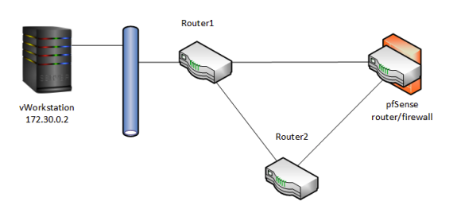

## Steps

### Phase 1: Local enumeration and gateway discovery
1. `ipconfig` showed the workstation at `172.30.0.2` with gateway `172.30.0.1`.
2. `arp -a` mapped the gateway's IP to its MAC address.
3. `ping` confirmed connectivity to the gateway.

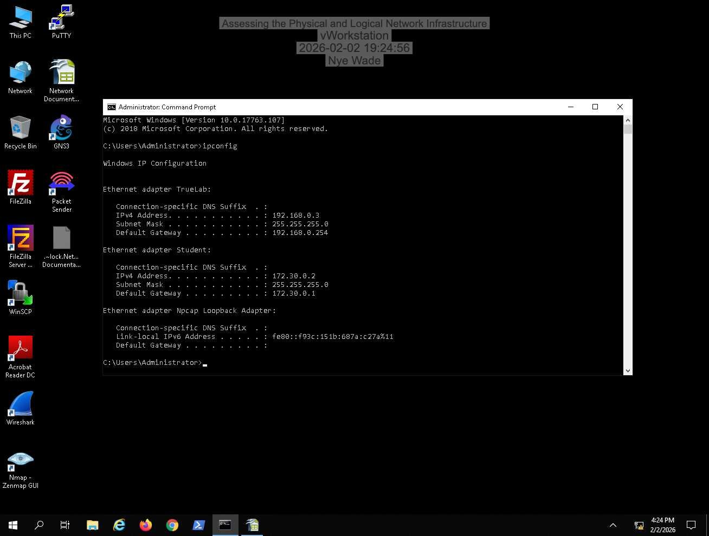
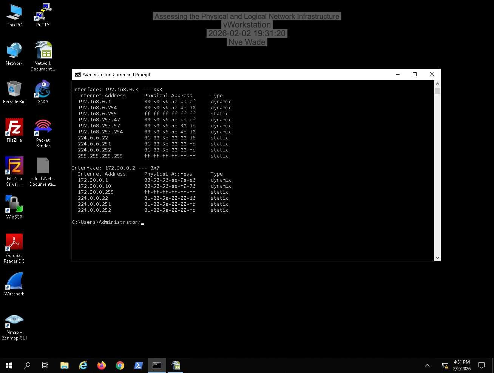

### Phase 2: Core router interrogation (Quagga)
1. Connected to Router 1 over **Telnet** and Router 2 over **SSHv2** with PuTTY.
2. Entered the Quagga shell with `sudo vtysh`.
3. Recorded interfaces and subnets with `show interface`.
4. Read the routing tables with `show ip route` to find directly connected networks and next hops.

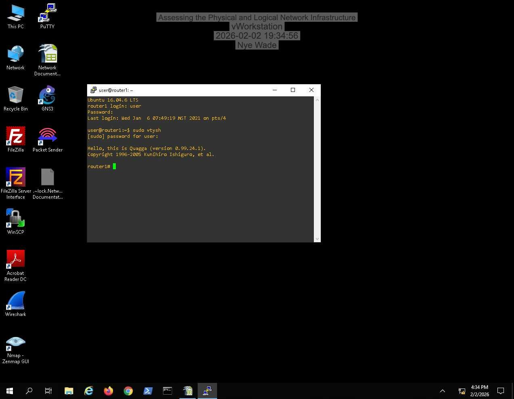
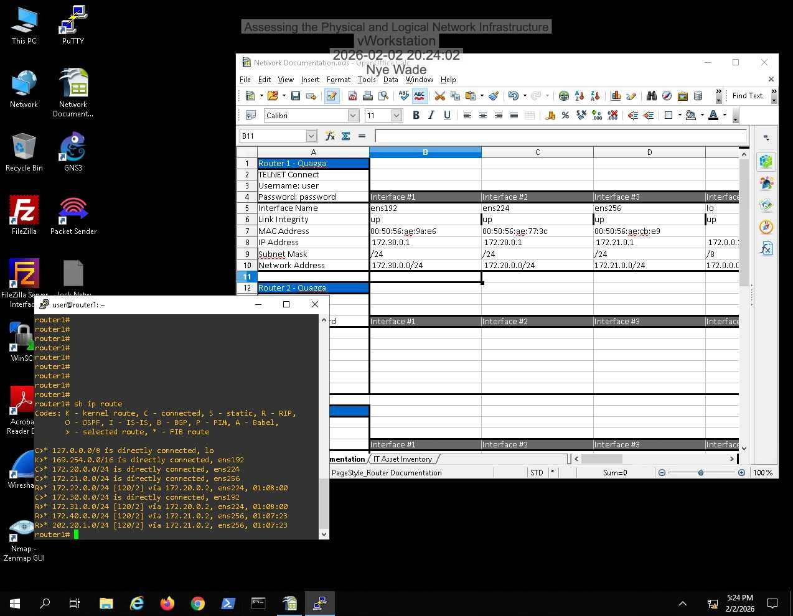
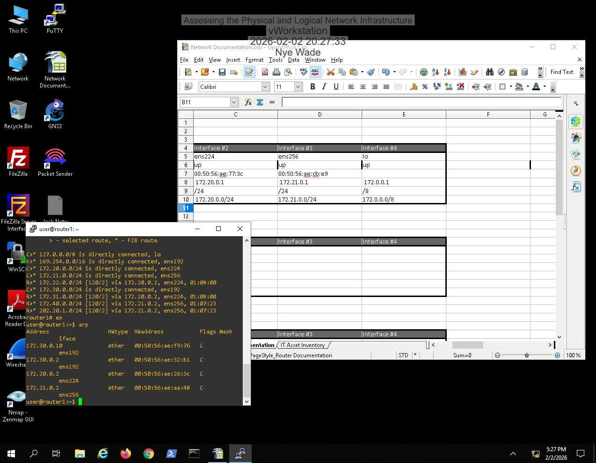
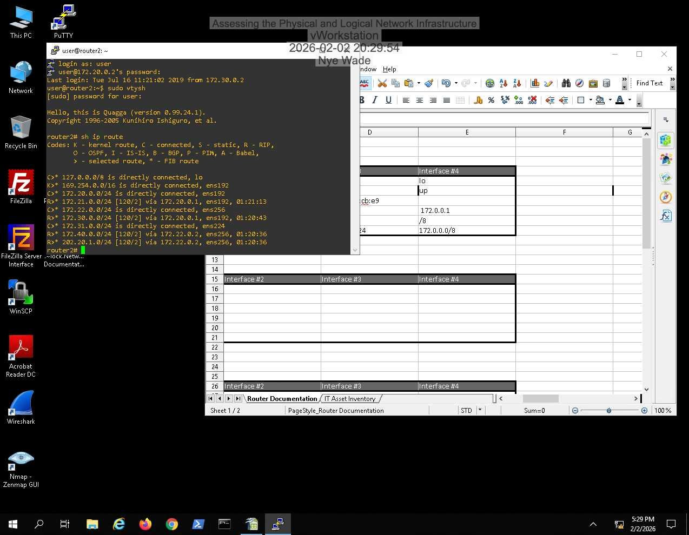
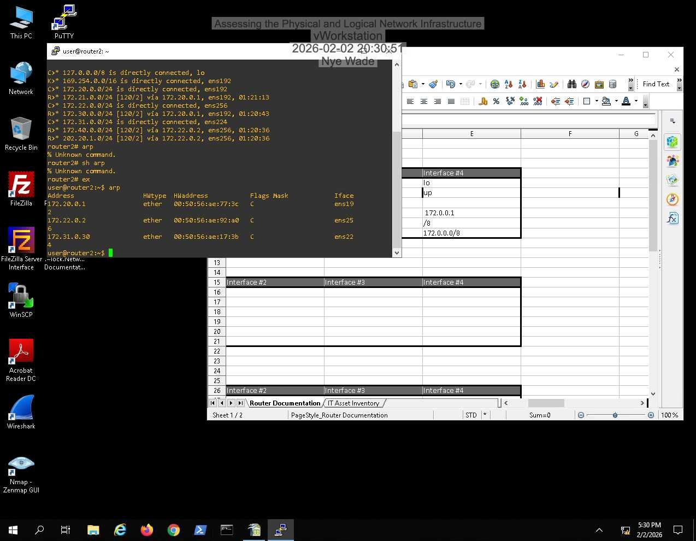

### Phase 3: Edge firewall (pfSense)
1. Logged into the pfSense web GUI at `172.21.0.2`.
2. Documented the WAN uplink (`vmx3`) and internal LAN segments.
3. Exported the firewall's routing and ARP tables to finish the topology map.

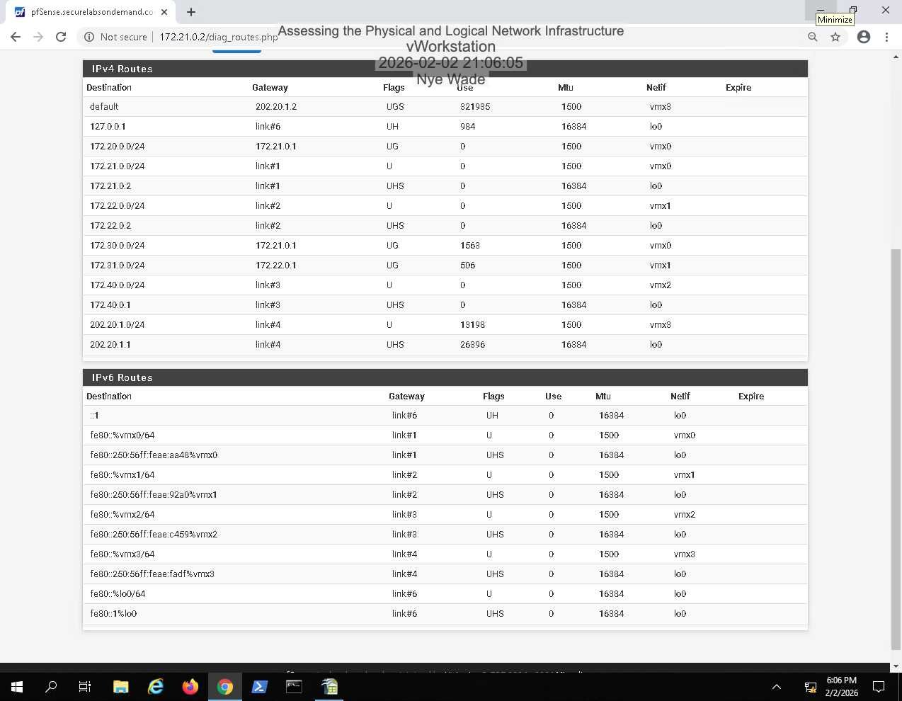
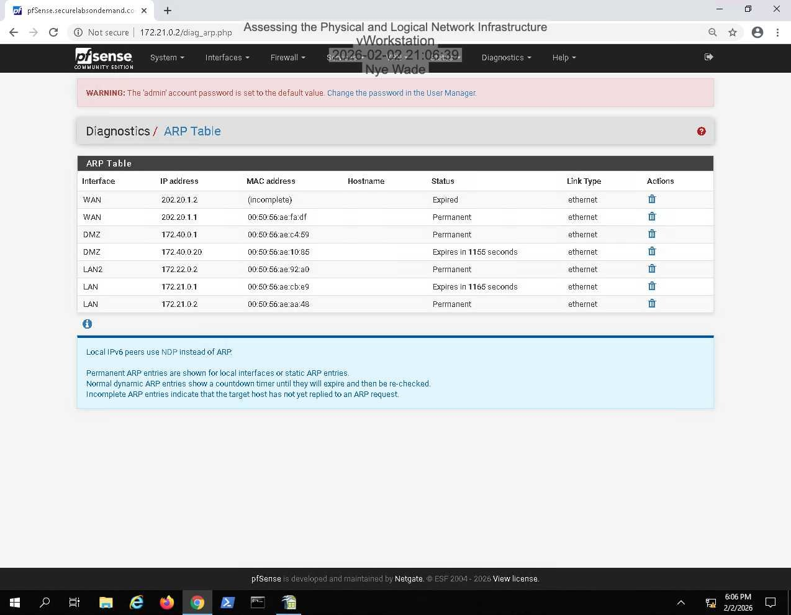

### Phase 4: Automated discovery with Nmap
```text
nmap -O 172.20,21,22,30,31,40.0.0/24
nmap -O -oX networkReport.xml 172.20,21,22,30,31,40.0.0/24
```
Ran host and OS discovery across all six segments, then converted the XML output into an HTML report.

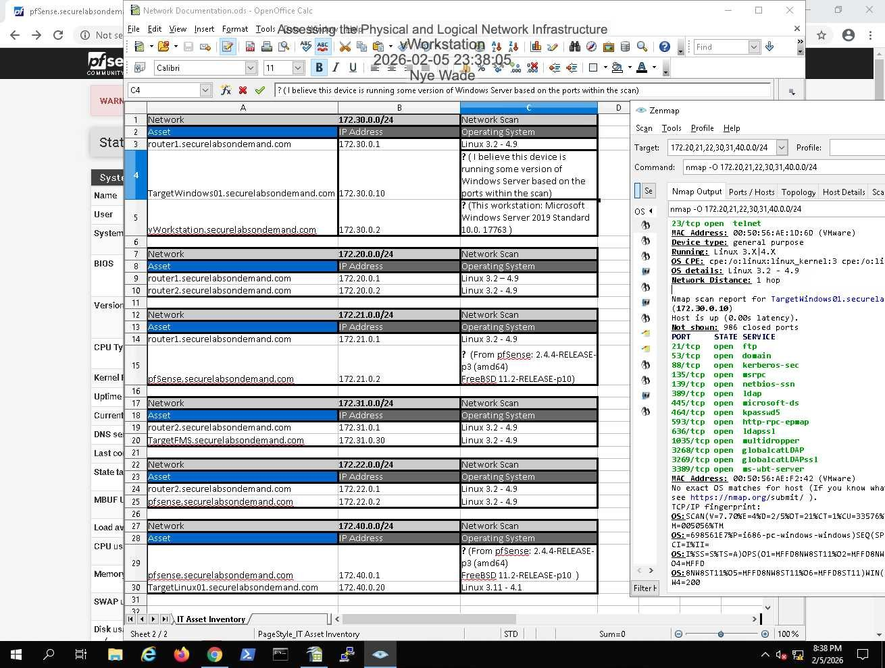
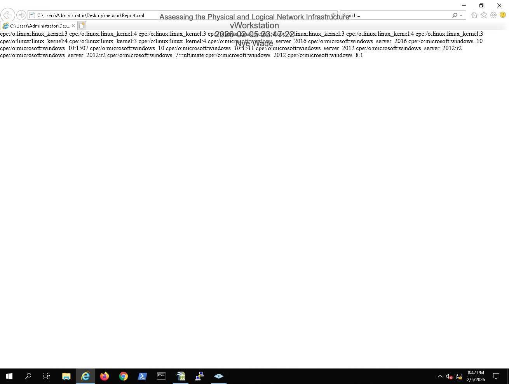

## Findings
- Six subnets (172.20/21/22/30/31/40.0.0/24) connected through two Quagga routers and a pfSense edge firewall.
- Every live host was matched to its IP, MAC, and OS in the inventory, including hosts that hadn't shown up during manual checks.
- Router 1 was managed over **Telnet**, which sends credentials in cleartext. In a real network that should be replaced with SSH.

## What I learned
- Manual enumeration tells you *how* the network is wired (routes, neighbors); scanning tells you *what* is on it. You need both to get a full picture.
- An accurate inventory is the starting point for security. You can't protect hosts you don't know exist.

## Skills demonstrated
Network reconnaissance, IP routing and ARP analysis, CIDR subnetting, Nmap, pfSense, SSH/Telnet, technical documentation
