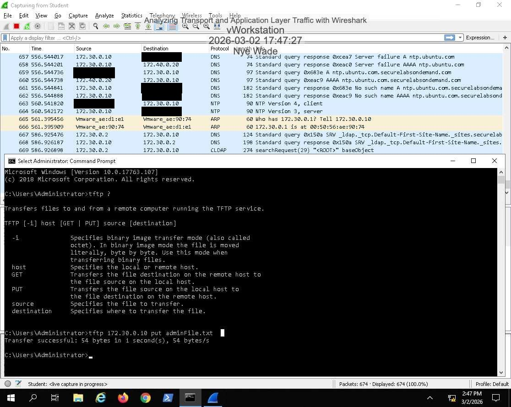
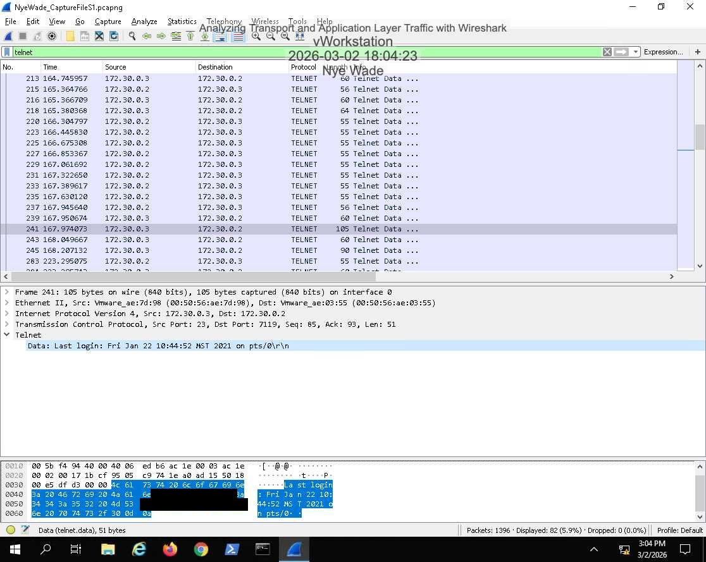
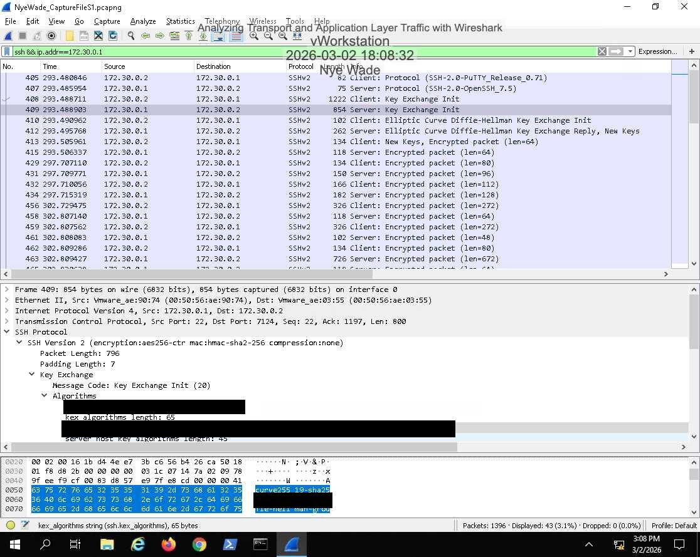
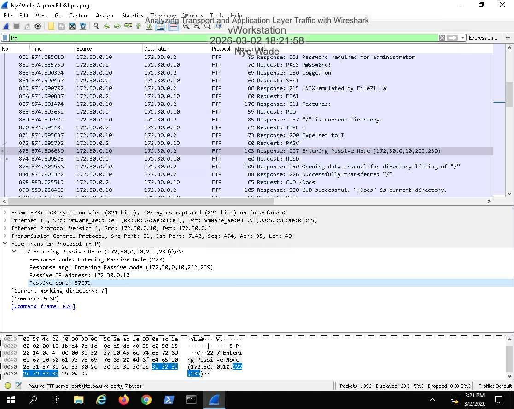
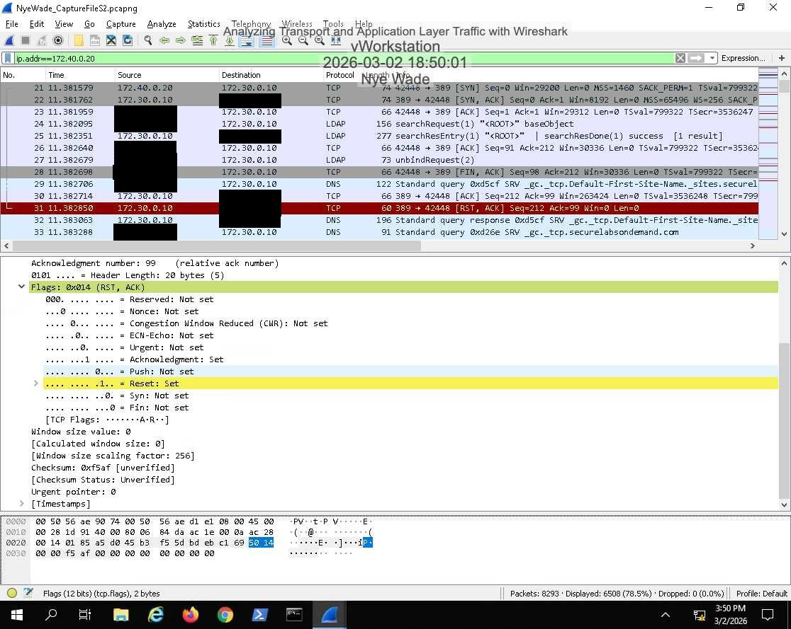
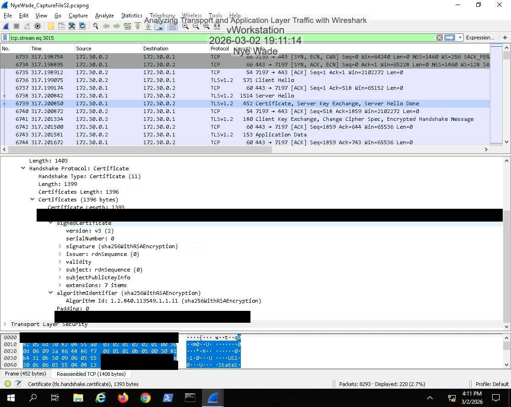
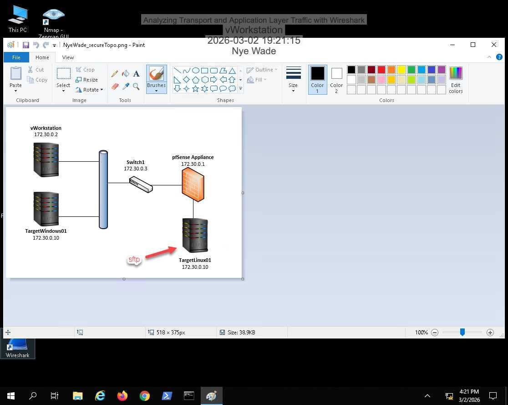

# Lab 02: Transport and Application Layer Traffic Analysis

## Overview
Generated file transfers and remote sessions over several protocols, captured them in Wireshark, and compared what each one exposes on the wire. Then looked at TCP connection control (RST, FIN/ACK), TLS, and rebuilt a file from a captured TCP stream.

## Objectives
- Generate TFTP, FTP, SFTP, Telnet, SSH, and netcat traffic
- Identify transport-layer behavior: ports, passive FTP, TCP flags
- Compare cleartext and encrypted application protocols
- Reassemble transferred data from a capture

## Environment / Tools
Hosted virtual lab: Windows workstation and Linux hosts. Tools: Wireshark, Tftpd64, FileZilla/WinSCP, PuTTY, `netcat`, Command Prompt.

## Steps

### Section 1: Protocol comparison
1. Transferred files over TFTP (checked the Tftpd64 server log) and SFTP.
2. In Wireshark, read Telnet login details in cleartext, then compared SSHv2, where only the negotiated cipher and MAC algorithms are visible before the payload is encrypted.
3. Found the destination port of the initial TFTP request (UDP 69) and the passive data port an FTP server announced.

### Section 2: Transport behavior and data recovery
1. Sent data with `netcat` and completed a transfer from the Command Prompt.
2. Identified the first RST packet and the FIN/ACK teardown in the packet details.
3. Inspected TLS: encrypted application data and the server certificate details.
4. Followed a TCP stream and rebuilt a PNG file from its bytes.

## Findings
| Protocol | Transport | What a sniffer sees |
|----------|-----------|---------------------|
| TFTP | UDP 69, then ephemeral ports | Whole file, no authentication |
| FTP | TCP 21 control, passive data port | Credentials and data in cleartext |
| Telnet | TCP 23 | Login details and session text |
| SSH / SFTP | TCP 22 | Algorithm negotiation, then encrypted data |
| HTTPS (TLS) | TCP 443 | Certificate details and encrypted records |

Anything sent over an unencrypted protocol, including whole files, can be pulled straight out of a capture.

## What I learned
- How the transport layer manages connections: the handshake, RST for a refused or aborted connection, FIN/ACK for a clean close.
- Passive FTP opens a second port, which is why FTP is awkward through firewalls.
- Rebuilding a PNG from captured bytes made data exfiltration risk concrete.

I did not finish the Section 3 challenge (carving a RAR archive out of a capture).

## Skills demonstrated
Wireshark, TCP/UDP analysis, TLS, FTP/TFTP/SFTP, SSH, netcat, file carving from packet captures
