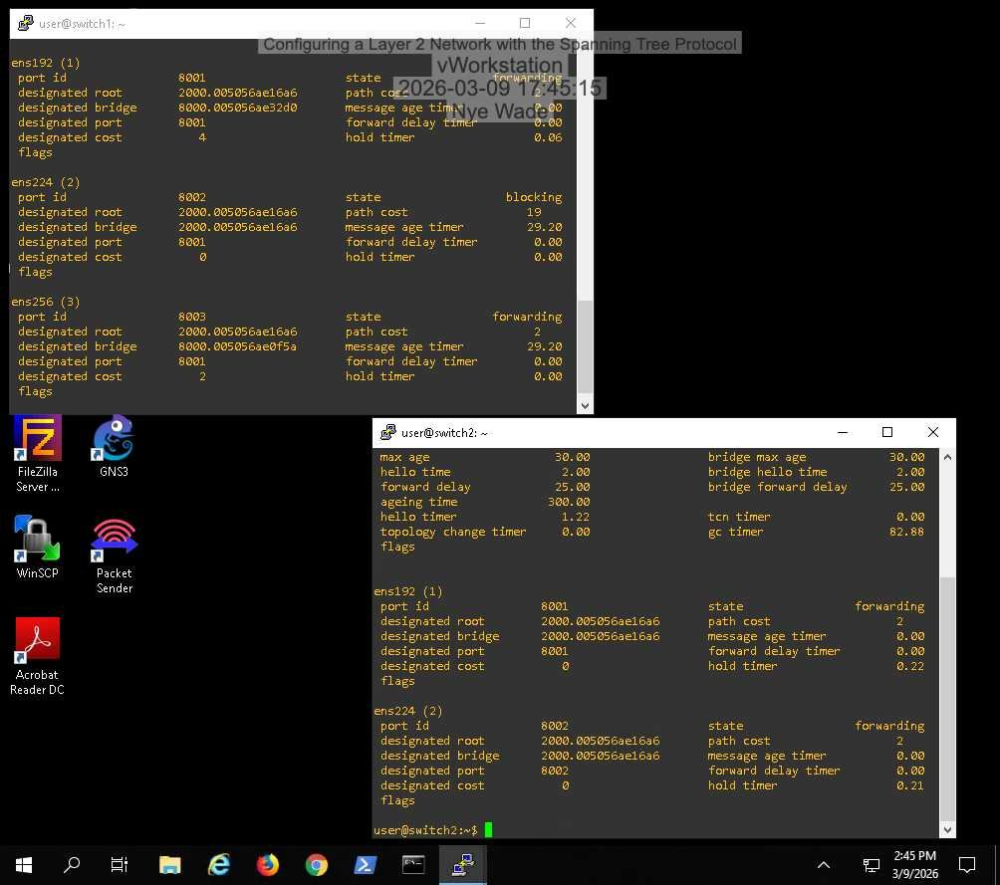
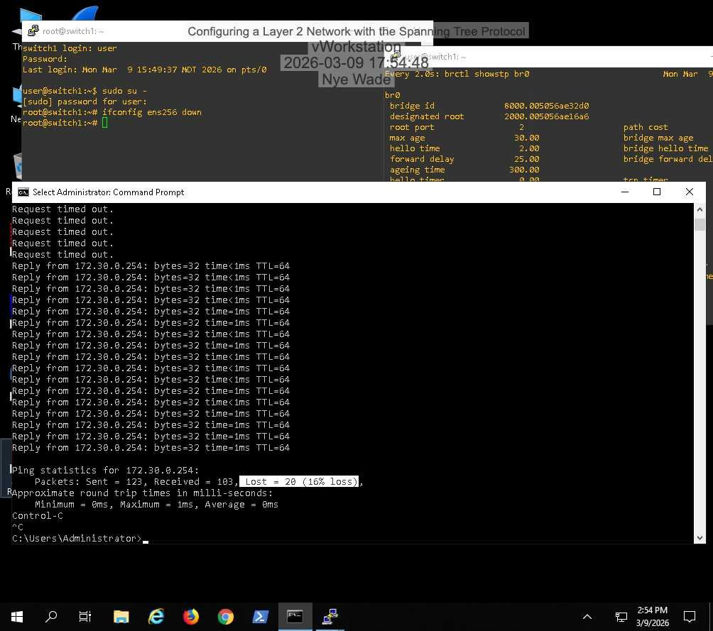
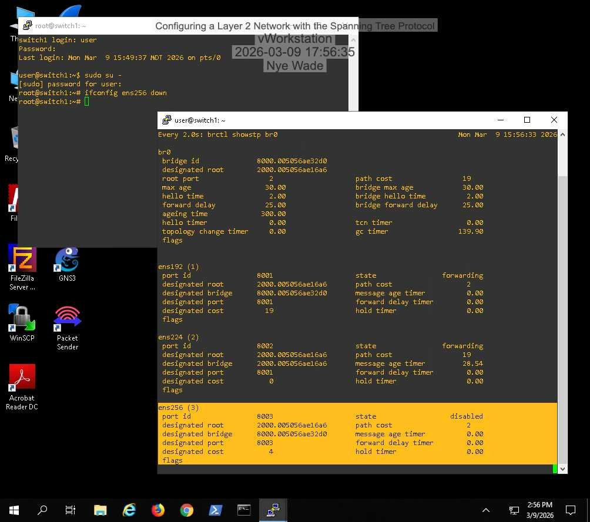
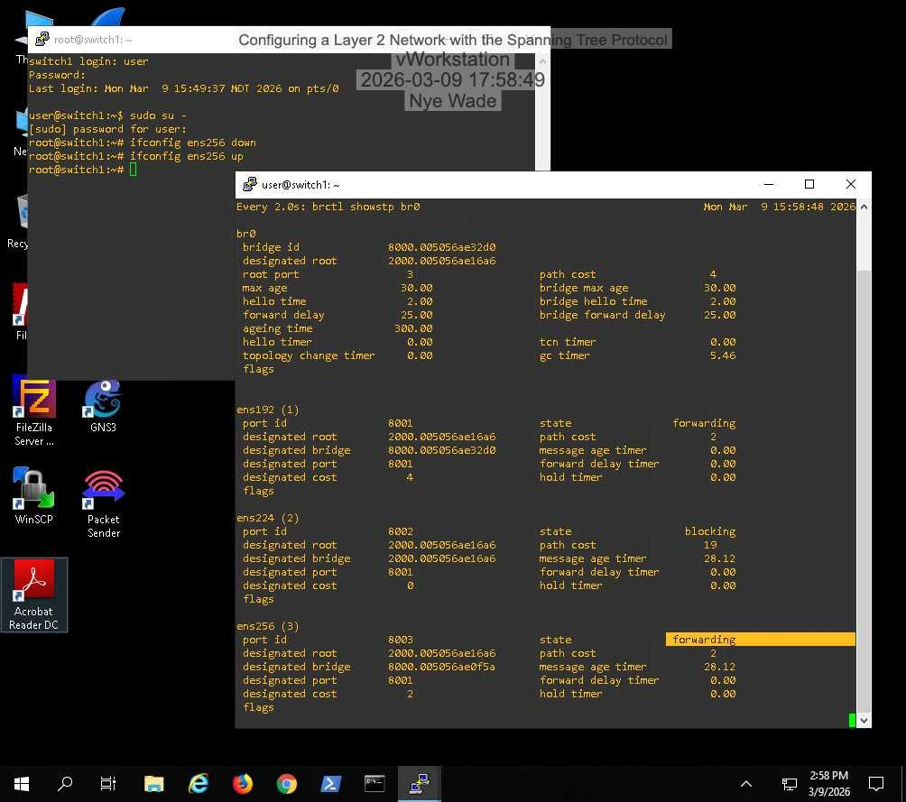

# Lab 03: Layer 2 Network with the Spanning Tree Protocol

## Overview
Examined a switched network with redundant links running STP, identified the root bridge and port roles, then took a forwarding link down to watch STP fail over to the blocked path and recover.

## Objectives
- Read STP state on Linux bridge switches
- Identify the root bridge, designated ports, and blocked ports
- Observe how STP reroutes traffic when a link fails

## Environment / Tools
Hosted virtual lab: Windows workstation and three Linux switches using `br0` bridges. Tools: Command Prompt `ping`, PuTTY, `brctl showstp br0`, `ifconfig`.

## Steps
1. Confirmed connectivity from the workstation to the gateway (`ping 172.30.0.254`).
2. On Switch2, compared the bridge ID with the designated root to find the root bridge.
3. On Switch3, confirmed which ports were forwarding.
4. Started a continuous ping, then brought down the forwarding port `ens256` (`ifconfig ens256 down`). Counted lost packets while STP reconverged through the previously blocked port.
5. Brought `ens256` back up and watched it return to forwarding.

## Findings
- The root bridge is the switch whose bridge ID matches the designated root on every switch.
- Redundant links stay blocked until needed, which prevents broadcast loops.
- Failover worked but wasn't instant: about 20 of 120 pings were lost while ports moved through listening and learning (default forward delay of 15 seconds per state).

## What I learned
STP trades convergence time for loop prevention. On a network with legacy STP timers, a link failure means tens of seconds of outage, which is why Rapid STP exists.

I completed Section 1. I did not finish Section 2 (MAC tables and timer tuning) or the challenge (path cost and root bridge changes).

## Skills demonstrated
Spanning Tree Protocol, Linux bridging, Layer 2 troubleshooting, failover testing
