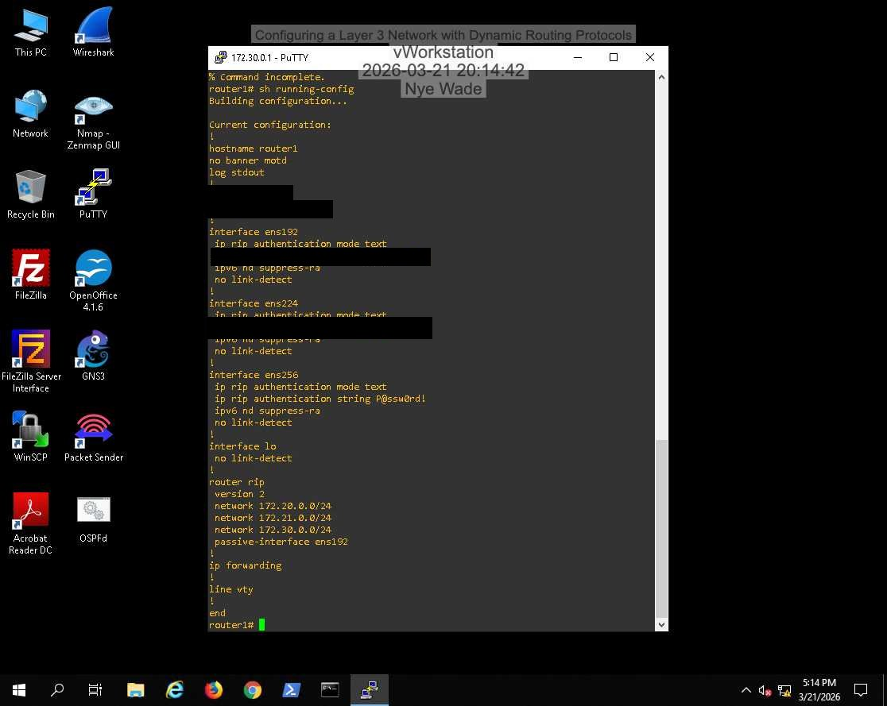
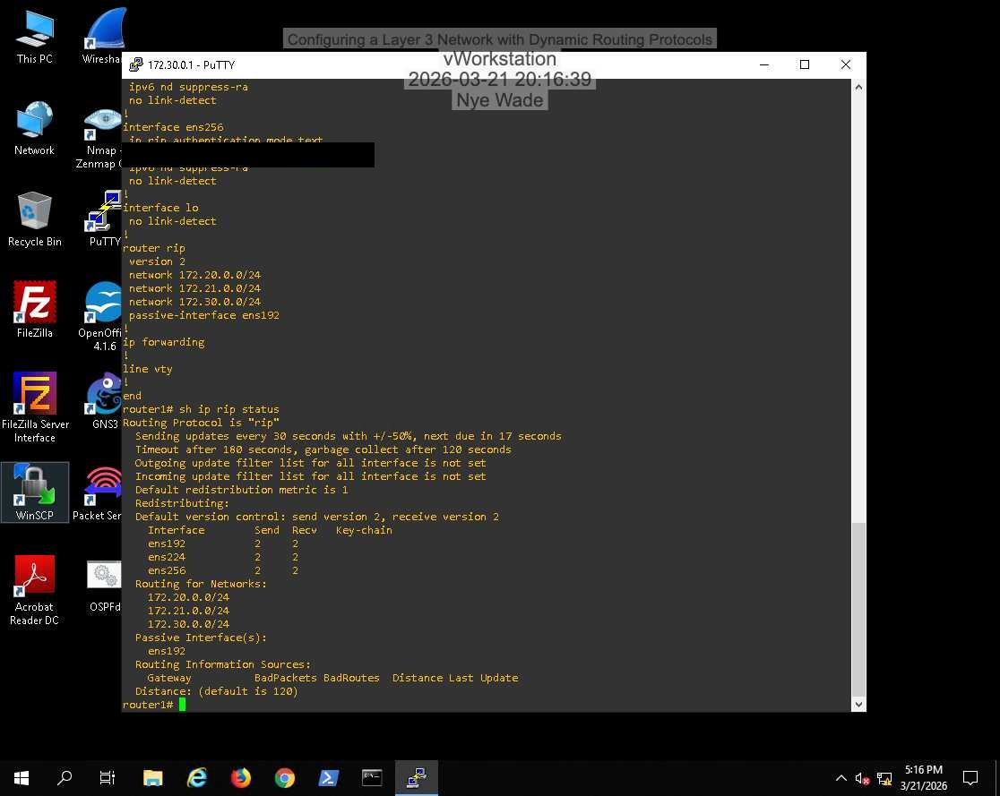
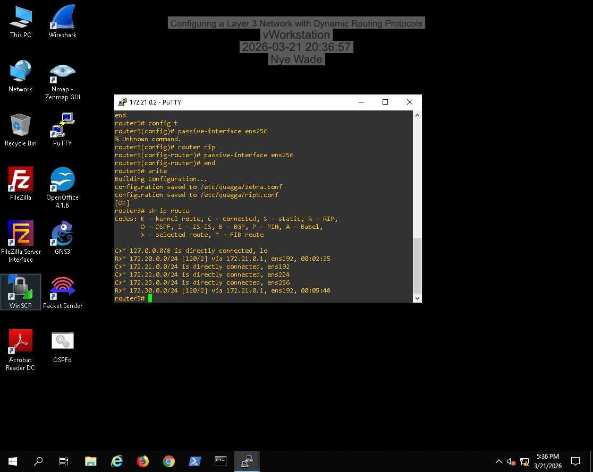
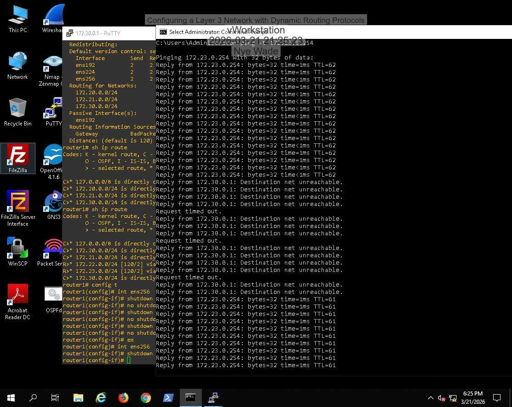
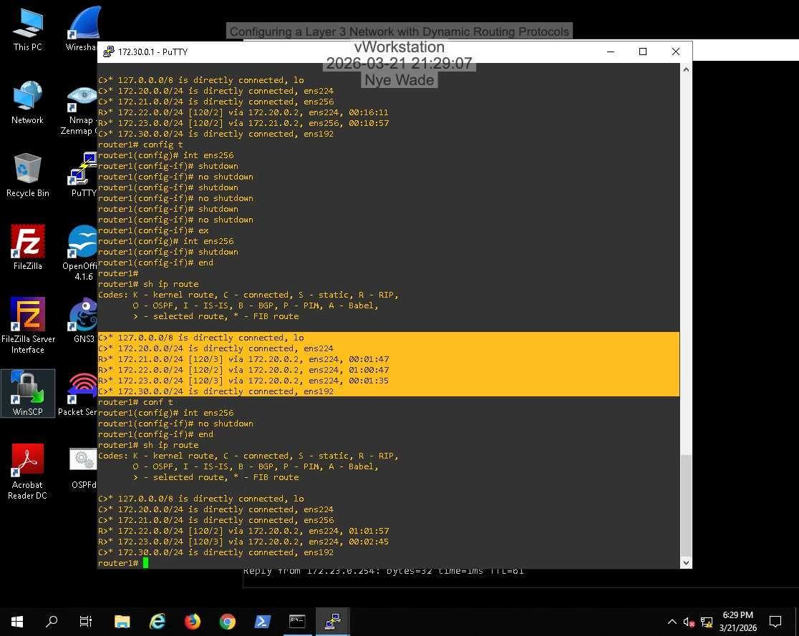

# Lab 04: Layer 3 Network with Dynamic Routing (RIPv2)

## Overview
Configured RIPv2 with authentication on three Quagga routers, verified the routes each one learned, then cut a link to watch RIP detect the failure and reconverge.

## Objectives
- Configure RIPv2 on multiple routers
- Verify RIP status and learned routes
- Observe convergence after a link failure

## Environment / Tools
Hosted virtual lab: Windows workstation, three Ubuntu routers running Quagga, pfSense. Tools: PuTTY, `vtysh`, `show running-config`, `show ip rip status`, `show ip route`, `ping`.

## Steps
1. On router1 and router2, enabled RIP version 2, added the connected networks, and set RIP authentication (`ip rip authentication mode text` with a shared string) on the router-facing interfaces.
2. Checked `show ip rip status` for version, timers, and neighbors.
3. Confirmed router3 learned the remote networks (`R` routes in `show ip route`).
4. Ran a continuous ping, then removed the `ens256` link on router1. Watched "Destination net unreachable" replies until RIP routed around the failure.
5. Compared router1's routing table after the link removal and after restoring it.

Authentication strings and router passwords are redacted in the screenshots.

## Findings
- RIP needs no manual route entries; routers learn the topology from each other.
- Convergence is slow. Pings failed with "Destination net unreachable" until the RIP timers expired and the alternate path was used.
- RIP authentication stops a rogue device from injecting routes, but text mode sends the key in the clear. MD5 mode would be the better choice outside a lab.

## What I learned
Distance-vector routing is simple to set up but slow to recover. That's the main reason link-state protocols like OSPF are preferred in larger networks.

I completed Section 1. I did not finish Section 2 (OSPFv2) or the OSPF cost challenge.

## Skills demonstrated
RIPv2, Quagga/vtysh, routing tables, route authentication, convergence testing
